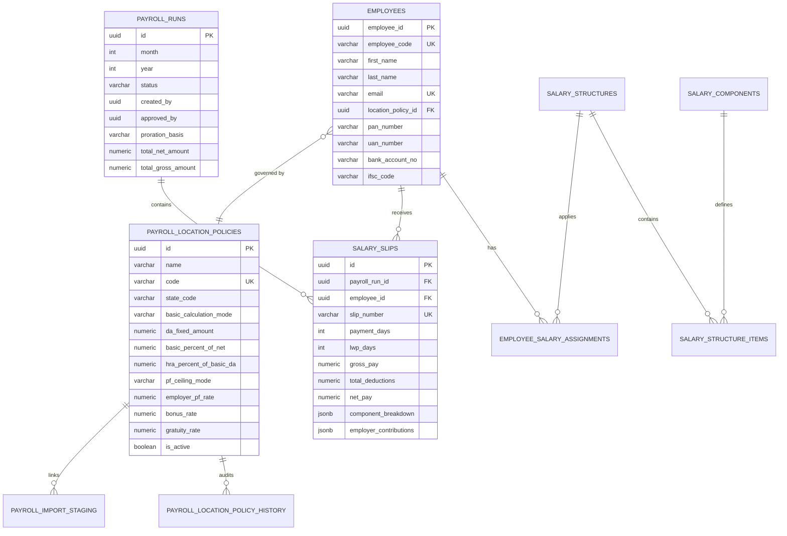

# PatilOne Enterprise Portal (TimeTrakPro) — End-to-End System Architecture & Feature Reference

**Author:** Senior Full-Stack Engineer, Payroll Domain Specialist & Software Architect  
**Classification:** Enterprise System Specification  
**Version:** 3.0 (Post-Audit Revision & Multi-Location Engine)  
**Date:** November 2026  

---

## Table of Contents
1. [Executive Summary & System Vision](#1-executive-summary--system-vision)
2. [Platform Architecture & Technology Stack](#2-platform-architecture--technology-stack)
3. [Authentication, Authorization & Security Architecture](#3-authentication-authorization--security-architecture)
4. [Time & Attendance Tracking Suite](#4-time--attendance-tracking-suite)
5. [Timesheets, Projects & Ticket Allocation Engine](#5-timesheets-projects--ticket-allocation-engine)
6. [Leave, Travel & Expense Management Suite](#6-leave-travel--expense-management-suite)
7. [Enterprise Portal & Workforce Collaboration](#7-enterprise-portal--workforce-collaboration)
8. [Comprehensive Payroll & Statutory Compliance Engine (Deep Dive)](#8-comprehensive-payroll--statutory-compliance-engine-deep-dive)
   - [8.1 Compensation Architecture & Salary Structures](#81-compensation-architecture--salary-structures)
   - [8.2 Mode A: Net-to-CTC Matching Engine (Plant/Factory Model)](#82-mode-a-net-to-ctc-matching-engine-plantfactory-model)
   - [8.3 Mode B: CTC-to-Net Reverse Engine (Corporate Model)](#83-mode-b-ctc-to-net-reverse-engine-corporate-model)
   - [8.4 Dynamic Location Policies & Multi-Branch Configuration](#84-dynamic-location-policies--multi-branch-configuration)
   - [8.5 Indian Statutory Rules Sub-Engines](#85-indian-statutory-rules-sub-engines)
     - [EPF, EPS, EDLI & VPF Compliance](#epf-eps-edli--vpf-compliance)
     - [ESIC Statutory Rules & Rule 50 Continuity Proviso](#esic-statutory-rules--rule-50-continuity-proviso)
     - [Multi-State Professional Tax (Maharashtra, MP, GJ, KA, etc.)](#multi-state-professional-tax)
     - [TDS Withholding under Section 192 (AY 2026-27 & AY 2025-26)](#tds-withholding-under-section-192)
     - [Payment of Gratuity Act, 1972 (Costing Accrual vs Statutory Vesting)](#payment-of-gratuity-act-1972)
   - [8.6 Payroll Proration & Attendance Policy Engine](#86-payroll-proration--attendance-policy-engine)
   - [8.7 Maker-Checker Workflow & Governance State Machine](#87-maker-checker-workflow--governance-state-machine)
   - [8.8 Banking Disbursal & Statutory Return Export Services](#88-banking-disbursal--statutory-return-export-services)
   - [8.9 Bulk Employee Onboarding & Staging Engine (300+ Workforce)](#89-bulk-employee-onboarding--staging-engine-300-workforce)
   - [8.10 Kredily Shadow Run Pilot Comparison Engine](#810-kredily-shadow-run-pilot-comparison-engine)
9. [Database Schema Architecture & Relational Model](#9-database-schema-architecture--relational-model)
10. [Comprehensive REST API Reference](#10-comprehensive-rest-api-reference)
11. [Deterministic Verification & Automated Test Suite](#11-deterministic-verification--automated-test-suite)
12. [Deployment, Scalability & Operations Runbook](#12-deployment-scalability--operations-runbook)

---

## 1. Executive Summary & System Vision

**Shende Industries Enterprise Portal (PatilOne / TimeTrakPro)** is a production-grade, enterprise workforce operations platform combining:
- Precision workforce time tracking, geofenced mobile/web attendance, and project timesheets.
- End-to-end task, ticket, client, and project lifecycle management.
- Leave approvals, expense vouchers, company announcements, policy document management, and recruitment workflows.
- A **native, legally hardened Indian payroll management system** engineered to eliminate CTC reconciliation mismatches, statutory non-compliance penalties, and manual spreadsheet friction across both corporate offices and multi-plant factory networks.

### Core Problems Solved
1. **Zero-Rupee CTC Reconciliation**: Bridges the gap between target employee take-home pay and loaded company budget without floating-point drift or unallocated rupee variances.
2. **Statutory Integrity**: Fully compliant with current Indian labor legislation, EPFO circulars (including post-2014 EPS exclusions and EDLI caps), ESIC Rule 50 continuity provisions, Maharashtra Act XIX of 2023 Professional Tax gazette rules, and Union Budget AY 2026–27 New Tax Regime (Section 115BAC) rebate structures.
3. **Multi-Location Agility**: Configurable branch policies allowing HR to tune Dearness Allowance (DA), HRA percentages, local state tax slabs, and fixed allowances on the fly without engineering code deployments or hardcoded location logic.
4. **Scale & High Throughput**: Built to process 300+ employees in sub-second batch cycles, complete with bulk Excel/CSV onboarding staging.

---

## 2. Platform Architecture & Technology Stack

The platform follows a clean decoupled client-server architecture:

```
┌────────────────────────────────────────────────────────────────────────┐
│                          CLIENT TIER (React 19)                        │
│  - Vite 7 Bundler (Strict Tree Shaking & Vendor Chunking)              │
│  - Tailwind CSS + Lucide Icons + Framer Motion + Sonner                │
│  - Lenis Smooth Scroll Engine + Reactive UI Architecture               │
└───────────────────────────────────┬────────────────────────────────────┘
                                    │ HTTPS / REST (JSON & Raw Buffers)
                                    ▼
┌────────────────────────────────────────────────────────────────────────┐
│                        BACKEND API TIER (Node.js)                      │
│  - Node.js (ES Modules, Express.js Router Architecture)                │
│  - JWT Bearer Token Authentication + Refresh Token Rotation            │
│  - Role-Based Access Control (RBAC) Middleware                         │
│  - Streaming Raw Parsers (ExcelJS, CSV Stream Readers)                 │
└───────────────────────────────────┬────────────────────────────────────┘
                                    │ PostgreSQL Pool (pg Driver)
                                    ▼
┌────────────────────────────────────────────────────────────────────────┐
│                         DATA TIER (PostgreSQL)                         │
│  - Connection Pooling with fail-fast lambdas & statement timeouts      │
│  - Immutable Audit History Tables & Financial Ledger Constraints       │
│  - Auto-updating Triggers, Foreign Keys & Partial Unique Indexes       │
└────────────────────────────────────────────────────────────────────────┘
```

### Technology Matrix
| Layer | Technology | Key Capabilities & Rationale |
|---|---|---|
| **Frontend Framework** | React 19, Vite 7 | High performance, modern concurrent rendering, fast HMR |
| **Styling & UI** | Tailwind CSS, Lucide Icons | Responsive enterprise dashboard aesthetics, zero runtime CSS bloat |
| **Smooth Motion** | Lenis, Framer Motion | Smooth desktop scrolling, animated modals, seamless page transitions |
| **Backend Runtime** | Node.js (ESM), Express.js | Native ES module support, non-blocking asynchronous event loop |
| **Database Engine** | PostgreSQL 15+ | ACID transactions, JSONB indexing, financial decimal precision |
| **Spreadsheet Processing** | ExcelJS | Enterprise XLSX stream generation, bank export generation, bulk parsing |
| **Testing Harness** | Node.js Test Runner & Assert | Deterministic zero-dependency automated test execution |

---

## 3. Authentication, Authorization & Security Architecture

### Role-Based Access Control (RBAC)
The system enforces strict multi-role separation across four core personas:
1. **ADMIN**: Full administrative governance across enterprise settings, user provisioning, role assignments, financial finalize authorizations, system audit logs, and company-wide reports.
2. **HR**: Compensation administration, payroll run creation, salary structure authoring, statutory reporting, employee onboarding, leave management, and location policy configuration.
3. **MANAGER**: Departmental attendance approvals, timesheet approvals, project ticket allocations, team leave tracking, and travel claim reviews.
4. **EMPLOYEE**: Self-service portal for clocking attendance, submitting daily timesheets, viewing payslips, applying for leaves, and submitting expense reimbursement vouchers.

### Security Defenses
- **JWT Authentication & Token Lifecycle**: Access tokens signed with HMAC SHA-256 with short lifespans (15 minutes). Refresh tokens securely hashed and persisted in the database with automatic rotation.
- **Self-Approval Prevention (Maker-Checker)**: A hard barrier prevents any user who drafted or submitted a payroll run from approving or finalizing their own submission.
- **OWASP Bank CSV Formula Injection Prevention**: Automated sanitization prefixes dangerous characters (`=`, `+`, `-`, `@`) with single quotes to neutralize spreadsheet macro execution when opening banking files in Microsoft Excel or LibreOffice.
- **Sensitive Data Masking**: Bank account numbers, PAN numbers, and salary slip details are masked (`•••••••1234`) on unprivileged client screens.
- **Negative Balance & Check Constraints**: PostgreSQL constraints guarantee that gross pay, deductions, and net pay cannot be negative, preventing fraudulent or inverted payroll postings.

---

## 4. Time & Attendance Tracking Suite

```
  ┌────────────────┐     Geofence / IP Validated     ┌────────────────┐
  │  Clock In /    │ ──────────────────────────────> │   Attendance   │
  │  Clock Out     │                                 │     Record     │
  └────────────────┘                                 └────────────────┘
           │                                                  │
           ▼                                                  ▼
  ┌────────────────┐     Manager Review / Audit      ┌────────────────┐
  │ Break Tracking │ ──────────────────────────────> │ Monthly Report │
  │ & Overtime     │                                 │ & LOP Summary  │
  └────────────────┘                                 └────────────────┘
```

### Features
1. **Live Clock In / Clock Out**: Real-time punch tracking recording timestamp, IP address, device metadata, and GPS geofence coordinates against registered office/plant perimeters.
2. **Break & Shift Tracking**: Configurable break intervals (lunch, tea, shift handovers) with duration monitoring to compute exact net productive hours.
3. **Attendance Master Desk**: HR and Manager dashboard displaying real-time office presence, absent rosters, late-in flags, and early-out alerts.
4. **Automatic Checkout & Night Shifts**: Configurable scheduled cron/workers to flag abandoned sessions and calculate overnight factory shift transitions.
5. **Deduction & Loss of Pay (LOP) Inputs**: Integrates directly with the payroll calculation engine to export payable days and unexcused absent days into monthly payroll batches.

---

## 5. Timesheets, Projects & Ticket Allocation Engine

1. **Project & Client Hierarchy**:
   - Clients $\rightarrow$ Projects $\rightarrow$ Milestones $\rightarrow$ Tickets/Tasks.
   - Project assignment controls restricting employee timesheet logging only to approved active engagements.
2. **Cross-Role Timesheet Logger**:
   - Daily and weekly grid views allowing employees to log hours against specific client projects, tickets, and work descriptions.
   - Segregation between billable and non-billable hours for client invoicing.
3. **Ticket Assignment Engine**:
   - Managers and Admins can assign project tickets, set severity levels (Urgent, High, Medium, Low), and monitor progress through Kanban / list views.
4. **Timesheet Approval Workflow**:
   - One-click weekly submission by employees.
   - Manager approval/rejection with inline revision requests.
   - Comprehensive audit trails tracking historical adjustments.

---

## 6. Leave, Travel & Expense Management Suite

1. **Leave Management Engine**:
   - Configurable leave types: Casual Leave (CL), Sick Leave (SL), Privilege/Earned Leave (PL/EL), Maternity Leave, and Compensatory Off.
   - Automated monthly accruals, annual carry-forward rules, and encashment tracking.
   - Real-time leave calendar preventing simultaneous team under-staffing.
   - Approved unpaid leaves automatically map to Loss of Pay (LOP) deductions during payroll processing.
2. **Travel & Expense Management**:
   - Travel request authorizations for client visits, field deployments, and inter-branch relocations.
   - Digital expense voucher submission with receipt image/PDF attachments.
   - Mileage tracking and per diem daily allowance calculations.
   - Two-tier approval flow (Department Manager $\rightarrow$ HR/Accounts).
   - Tax-exempt reimbursement categorization (Section 10(14) compliant) preventing expense claims from being taxed as salary income.

---

## 7. Enterprise Portal & Workforce Collaboration

1. **Company Holidays Calendar**:
   - Multi-state holiday calendar supporting mandatory national holidays (Republic Day, Independence Day, Gandhi Jayanti) and state-specific festival holidays.
2. **Notice Board & Corporate Announcements**:
   - Enterprise broadcast system for HR memos, policy revisions, management communications, and security directives.
   - Read confirmations and expiry dates on announcements.
3. **Policy Document Vault**:
   - Centralized repository for employee handbooks, POSH guidelines, health & safety standards, IT security policies, and NDA templates.
4. **Recruitment & Applicant Pipeline**:
   - Sourcing tracker, interview scheduling, scorecard evaluations, candidate status pipeline (Screening $\rightarrow$ Technical $\rightarrow$ HR $\rightarrow$ Offer $\rightarrow$ Onboarded), and automatic transition into employee profiles upon hire.

---

## 8. Comprehensive Payroll & Statutory Compliance Engine (Deep Dive)

The payroll architecture represents an institutional-grade, zero-penny Indian payroll system:

```
┌────────────────────────────────────────────────────────────────────────┐
│                        COMPENSATION DEFINITION                         │
│  - Approved Annual CTC (Mode B) OR Target Net In-Hand (Mode A)         │
│  - Location Policy Rules (DA Fixed, HRA %, Allowances, PT Slabs)       │
└───────────────────────────────────┬────────────────────────────────────┘
                                    │
                                    ▼
┌────────────────────────────────────────────────────────────────────────┐
│                      STATUTORY CALCULATION ENGINE                      │
│  - EPF / EPS / EDLI / VPF (15k Cap, 25k Mode, Post-2014 EPS Excl)      │
│  - ESIC (₹21,000 wage ceiling, 0.75% + 3.25%, Rule 50 continuity)     │
│  - Multi-State PT (Maharashtra Act XIX/2023, MP PT 1995, GJ, KA, etc)   │
│  - Section 192 TDS (AY 2026-27 ₹12L Rebate, AY 2025-26, YTD Spread)   │
│  - Gratuity (4.81% Costing Accrual vs 5-Year Legal Statutory Vesting)  │
└───────────────────────────────────┬────────────────────────────────────┘
                                    │
                                    ▼
┌────────────────────────────────────────────────────────────────────────┐
│                       PAYROLL PRORATION ENGINE                         │
│  - Calendar Days vs Scheduled Working Days                             │
│  - Mid-Month Joiners & Leavers Proration                               │
│  - Salaried Pay Protection (Timesheets decoupled from baseline pay)    │
└───────────────────────────────────┬────────────────────────────────────┘
                                    │
                                    ▼
┌────────────────────────────────────────────────────────────────────────┐
│                  MAKER-CHECKER WORKFLOW STATE MACHINE                  │
│  Draft  ──>  Submitted  ──>  Approved  ──>  Finalized  ──>  Paid       │
│  (Self-approval blocked; rejection audit with mandatory feedback)      │
└───────────────────────────────────┬────────────────────────────────────┘
                                    │
                                    ▼
┌────────────────────────────────────────────────────────────────────────┐
│                   BANKING & STATUTORY EXPORT SUITE                     │
│  - Formula-Injection-Safe Bank Transfer CSVs (HDFC, ICICI, SBI)        │
│  - EPFO Electronic Challan Return (ECR) text generation               │
│  - ESIC Monthly Return & State PT Form 3 Statements                    │
└────────────────────────────────────────────────────────────────────────┘
```

---

### 8.1 Compensation Architecture & Salary Structures
Salaries in PatilOne are constructed from defined component groups:
1. **Earnings**:
   - `BASIC`: Core wage element (typically 40%–50% of CTC or Net).
   - `DA`: Dearness Allowance (branch-specific cost of living adjustment).
   - `HRA`: House Rent Allowance (5% of Basic+DA in plant models; 40%–50% in corporate models).
   - Fixed Allowances: Washing Allowance, Education Allowance, Conveyance Allowance, Medical Allowance, Books & Periodicals.
   - `SPECIAL_ALLOWANCE` / `OTHER_ALLOWANCE`: Mathematical balancing plug that absorbs residual salary to reach exact target CTC or Net without roundoff drift.
2. **Employee Deductions**:
   - Employee Provident Fund (12%).
   - ESIC Employee Contribution (0.75%).
   - Professional Tax (State Gazette slabs).
   - Voluntary PF (VPF).
   - Income Tax Withholding (TDS under Section 192).
3. **Employer Contributions & Cost Allocations**:
   - Employer EPF (3.67%) + EPS (8.33%) + EDLI (0.50% capped at ₹75) + Admin charges.
   - Employer ESIC (3.25%).
   - Statutory Bonus Provision (8.33% capped at ₹7,000 monthly ceiling).
   - Gratuity Cost Provision (4.81% per AS 15 accrual accounting).

---

### 8.2 Mode A: Net-to-CTC Matching Engine (Plant/Factory Model)
*Engineered to match the manufacturing plant payroll model reverse-engineered from `SIPL, CTC BOOK.xlsx`.*

When hiring or structuring factory staff, contracts often specify a fixed **Target Net In-Hand Salary** (e.g., ₹26,000/month). The Mode A engine computes the entire loaded cost structure backward:

1. **Basic Pay**:
   $$\text{Basic} = \text{Net Salary} \times \frac{\text{basic\_percent\_of\_net}}{100}$$
2. **Basic + DA**:
   $$\text{Basic+DA} = \text{Basic} + \text{da\_fixed\_amount}$$
3. **HRA**:
   $$\text{HRA} = (\text{Basic+DA}) \times \frac{\text{hra\_percent\_of\_basic\_da}}{100}$$
4. **Fixed Monthly Allowances**:
   $$\text{Fixed Allowances} = \text{Washing} + \text{Education} + \text{Conveyance} + \text{Medical} + \text{Books}$$
5. **Other Allowance (Balancing Plug)**:
   $$\text{Other Allowance} = \text{Net Salary} - (\text{Basic+DA} + \text{HRA} + \text{Fixed Allowances})$$
   *Validation Rule*: If `Other Allowance < 0`, the engine emits a **BLOCKING ERROR** (`NET_TOO_LOW`) stating the minimum net salary required for the configured allowances.
6. **PF Wages & Employee PF**:
   $$\text{PF Wage} = \min(\text{Basic+DA}, \text{PF Ceiling})$$
   $$\text{Employee PF} = \text{PF Wage} \times 12\%$$
7. **Professional Tax**: Computed via `calculateMultiStatePT` matching the location's state law and month (e.g. Maharashtra February ₹300 surcharge).
8. **Gross Salary (Pay Slip)**:
   $$\text{Gross Salary} = \text{Net Salary} + \text{Employee PF} + \text{Professional Tax}$$
9. **Employer Overhead Costs**:
   $$\text{Employer PF} = \text{PF Wage} \times 13\% \quad \text{(Cost modelling rate)}$$
   $$\text{Bonus} = \min(\text{Basic+DA}, ₹7,000) \times 8.33\% \quad \text{(Payment of Bonus Act ceiling)}$$
   $$\text{Gratuity Accrual} = (\text{Basic+DA}) \times 4.81\% \quad \text{(AS 15 employer cost accrual)}$$
10. **Loaded Monthly CTC**:
    $$\text{Monthly CTC} = \text{Gross Salary} + \text{Employer PF} + \text{Bonus} + \text{Gratuity}$$
    $$\text{Annual Loaded CTC} = \text{Monthly CTC} \times 12$$

**Zero-Variance Guarantee**: Every calculation verifies that:
$$\text{Gross Salary} + \text{Total Employer Costs} - \text{Monthly CTC} \equiv ₹0.00$$

---

### 8.3 Mode B: CTC-to-Net Reverse Engine (Corporate Model)
Used for salaried corporate employees hired on an **Approved Annual CTC** (e.g., ₹12,00,000/year):
1. Converts Annual CTC to Monthly CTC.
2. Derives Basic (typically 40%–50% of CTC).
3. Computes HRA (Metro 50% / Non-Metro 40% of Basic).
4. Determines statutory Employer PF, ESIC, and Gratuity.
5. Uses `Special Allowance` as the balancing plug:
   $$\text{Special Allowance} = \text{Monthly CTC} - (\text{Basic} + \text{HRA} + \text{Employer PF} + \text{Employer ESIC} + \text{Gratuity Provision})$$
6. If Special Allowance evaluates to negative, the engine flags a **CTC Deficit Error** prohibiting salary structure assignment until the CTC budget is corrected.

---

### 8.4 Dynamic Location Policies & Multi-Branch Configuration
HR administrators manage branch-specific rules through the **Location Policies** panel:
- **No Hardcoded Location Names**: Policies are user-defined (e.g., `Branch Alpha`, `Plant Beta`, `Corporate HQ`).
- **Configurable Parameters**:
  - State Code (`MH`, `MP`, `GJ`, `KA`, `TN`, `NONE`).
  - Fixed DA amount in ₹.
  - Basic pay percentage and mode (`PERCENT_OF_NET` vs `PERCENT_OF_CTC`).
  - HRA percentage of Basic+DA.
  - Fixed allowance amounts (Washing, Education, Conveyance, Medical, Books).
  - PF Ceiling mode (`ACTUAL`, `25000`, `15000`).
  - Costing percentages (Employer PF %, Bonus %, Gratuity %).
  - Default Tax Regime and Assessment Year.
- **Propagation**: Assigning an employee to a policy automatically connects their monthly pay calculations to that policy's rules.
- **Audit History**: Every edit creates a row in `payroll_location_policy_history` preserving reproducibility for historical audits.

---

### 8.5 Indian Statutory Rules Sub-Engines

#### EPF, EPS, EDLI & VPF Compliance
- **Wage Ceilings**: Default statutory wage ceiling is ₹15,000/month (EPF Scheme 1952, Paragraph 26A).
- **Higher Wage / Actual Mode**: Supports un-capped contributions under Paragraph 26(6) joint declarations.
- **Executive ₹25,000 Cap Mode**: Flagged with an informational compliance advisory because ₹25,000 is an internal company cap rather than an official statutory ceiling.
- **Post-2014 EPS Exclusion**: Pursuant to Supreme Court judgment (*EPFO vs Sunil Kumar*, 2022) and GSR 609(E) w.e.f. 01-09-2014, new members joining after Sept 1, 2014 with basic pay exceeding ₹15,000 are ineligible for EPS. 100% of the employer contribution ($12\%$) is allocated directly to EPF ($0\%$ to EPS).
- **EDLI Cap**: Strictly capped at ₹75/month (0.50% of ₹15,000 wage ceiling per Notification S.O. 2018(E)).
- **Voluntary Provident Fund (VPF)**: Supports voluntary additional employee deductions up to 100% of basic pay without requiring an employer match.

#### ESIC Statutory Rules & Rule 50 Continuity Proviso
- **Wage Ceiling**: ₹21,000/month gross wages (ESI Central Rules, Rule 50).
- **Contribution Rates**: Employee 0.75%, Employer 3.25% (total 4.00%).
- **Symmetric Rounding**: Both employer and employee shares use standard rounding (`Math.round`) ensuring zero fractional discrepancy.
- **Rule 50 Continuity Proviso**: Employees whose wages exceed ₹21,000 during a 6-month contribution period (April–September or October–March) remain legally covered and must have ESIC deducted until the end of that statutory contribution period.

#### Multi-State Professional Tax
- **Maharashtra (MH)**:
  - Authority: *Maharashtra Act No. XIX of 2023* (Gazette April 6, 2023).
  - Male Slabs: $\le \text{₹7,500}$: ₹0 | ₹7,501–₹10,000: ₹175 | $> \text{₹10,000}$: ₹200 (February ₹300).
  - Female Slabs: $\le \text{₹25,000}$: ₹0 (Statutory Exemption) | $> \text{₹25,000}$: ₹200 (February ₹300).
  - Annual Limit: ₹2,500.
- **Madhya Pradesh (MP)**:
  - Authority: *Madhya Pradesh Vritti Kar Adhiniyam, 1995*.
  - Slabs: $\le \text{₹9,999}$: ₹0 | ₹10,000–₹14,999: ₹125 | ₹15,000–₹19,999: ₹167 | $\ge \text{₹20,000}$: ₹208.
- **Gujarat (GJ)** & **Karnataka (KA)**: Slabs configured with automated verification flags.
- **Tamil Nadu (TN)**: Exempt (₹0).

#### TDS Withholding under Section 192
- **Assessment Year 2026-27 (New Tax Regime - Section 115BAC)**:
  - Standard Deduction: ₹75,000 for salaried employees.
  - Section 87A Rebate: Full tax rebate available up to ₹12,00,000 net taxable income (salaried gross up to **₹12,75,000 has zero income tax liability**).
  - Slabs: 0–4L: Nil; 4–8L: 5%; 8–12L: 10%; 12–16L: 15%; 16–20L: 20%; 20–24L: 25%; >24L: 30%.
  - Health & Education Cess: 4% applied to net tax after surcharge.
- **Assessment Year 2025-26 (Legacy Support)**:
  - Standard Deduction: ₹75,000.
  - Section 87A Rebate: Capped at ₹7,00,000 net taxable income (gross up to ₹7,75,000 has zero tax).
- **YTD Tax Spreading**: Dynamically recalculates remaining annual liability:
  $$\text{Monthly TDS} = \frac{\max(0, \text{Projected Annual Tax} - \text{YTD Tax Deducted})}{\text{Remaining Months in Financial Year}}$$

#### Payment of Gratuity Act, 1972
- **Costing Accrual vs Statutory Liability**:
  - *Costing Accrual (AS 15)*: Employer budget provision computed at 4.81% of Basic+DA from Day 1.
  - *Statutory Legal Liability (Section 4)*: Zero payable liability until an employee completes 5 years of continuous service.
  - Formula upon vesting: $\frac{\text{Last Drawn Basic+DA} \times 15 \times \text{Completed Years}}{26}$, capped at statutory ceiling of ₹20,00,000.

---

### 8.6 Payroll Proration & Attendance Policy Engine
- **Calendar Days vs Scheduled Working Days**: Configurable monthly denominator (e.g. 30/31 days vs 24/26 working days).
- **Mid-Month Joiner & Leaver Proration**:
  $$\text{Payment Days} = \max(0, \text{Calendar Days} - \text{Unpaid LOP Days} - \text{Pre-Joining Days} - \text{Post-Exit Days})$$
  $$\text{Earned Salary} = \text{Monthly Fixed Amount} \times \frac{\text{Payment Days}}{\text{Days in Month}}$$
- **Salaried Attendance Protection**: Salaried employees' pay is **not** reduced by project timesheet fluctuations unless an explicit hourly wage policy is configured for that individual.

---

### 8.7 Maker-Checker Workflow & Governance State Machine

```
┌─────────┐      Submit       ┌───────────┐      Approve      ┌──────────┐
│  DRAFT  │ ────────────────> │ SUBMITTED │ ────────────────> │ APPROVED │
└─────────┘                   └───────────┘                   └──────────┘
     ▲                              │                              │
     │       Reject with Reason     │                              │ Finalize
     └──────────────────────────────┘                              ▼
                                                              ┌──────────┐
                                                              │ FINALIZED│
                                                              └──────────┘
                                                                   │
                                                                   │ Record Payment
                                                                   ▼
                                                              ┌──────────┐
                                                              │   PAID   │
                                                              └──────────┘
```

1. **DRAFT**: HR creates run, triggers automated batch calculations.
2. **SUBMITTED**: HR locks attendance inputs and submits for formal approval.
3. **APPROVED**: Finance Manager / Senior Admin reviews validation summary and approves.
   *Anti-fraud guard: Submitter cannot approve.*
4. **REJECTED**: Reviewer returns draft to HR with mandatory written feedback.
5. **FINALIZED**: Admin locks records, assigns unique serial payslip numbers (`SLIP/2026/10/EMP001`), and prepares bank disbursement files.
6. **PAID**: Accounts records transaction reference and marks cycle complete.

---

### 8.8 Banking Disbursal & Statutory Return Export Services
1. **Bank Payment CSV Generator**:
   - Formats supported: Standard NEFT/RTGS, HDFC Corporate Banking, ICICI CMS, SBI Corporate.
   - Built-in validation verifying valid 11-character alphanumeric IFSC codes and 9-to-18 digit account numbers.
   - OWASP CSV formula sanitization applied to employee names and payment remarks.
2. **Statutory Return Exports**:
   - **EPFO ECR Text File**: Formatted with UAN, Member Name, Gross Wages, EPF Wages, EPS Wages, EDLI Wages, EE Share, ER Share, and EPS Allocation.
   - **ESIC Monthly Return**: IP Number, Employee Name, Days Worked, Total Monthly Wages, Employee Contribution.
   - **Professional Tax Form III**: Monthly state return statements aggregated by wage slab.

---

### 8.9 Bulk Employee Onboarding & Staging Engine (300+ Workforce)
- **High Performance Batch Ingestion**: Ingests and calculates hundreds of records in milliseconds.
- **Staging Architecture (`payroll_import_staging`)**: Decouples payroll data from system user authentication, allowing bulk HR uploads without dummy passwords or fake emails.
- **Format Agnostic**: Accepts both `.csv` and `.xlsx` files with automatic header mapping.
- **Pre-Import Validation**: Validates PAN regex, 12-digit UAN, 11-digit IFSC, and active location policy links with row-by-row error reporting.

---

### 8.10 Kredily Shadow Run Pilot Comparison Engine
Allows Shende Industries to run parallel payroll cycles alongside existing payroll providers (e.g. Kredily) before complete cutover:
- Uploads Kredily CSV salary register.
- Compares Gross Pay, Net Pay, EPF Employee, Employer EPF, ESIC, and PT side-by-side.
- Flags and diagnoses material statutory variances (e.g., EPF ₹15,000 ceiling discrepancies or female PT exemption gaps).

---

## 9. Database Schema Architecture & Relational Model



---

## 10. Comprehensive REST API Reference

### Payroll & Location Policy Endpoints
| HTTP Method | Route | Access | Description |
|---|---|---|---|
| `GET` | `/api/payroll/location-policies` | Admin, HR | List all active location payroll policies |
| `POST` | `/api/payroll/location-policies` | Admin, HR | Create a new location policy |
| `GET` | `/api/payroll/location-policies/:id` | Admin, HR | Retrieve details of a specific policy |
| `PUT` | `/api/payroll/location-policies/:id` | Admin, HR | Update policy parameters (logs audit record) |
| `DELETE` | `/api/payroll/location-policies/:id` | Admin, HR | Soft-deactivate a location policy |
| `GET` | `/api/payroll/location-policies/:id/history` | Admin, HR | View immutable audit history of changes |
| `POST` | `/api/payroll/location-policies/simulate` | Admin, HR | Interactive simulation (Mode A & Mode B) |
| `GET` | `/api/payroll/bulk-import/template` | Admin, HR | Download standardized onboarding CSV template |
| `POST` | `/api/payroll/bulk-import/preview` | Admin, HR | Validate upload file without saving |
| `POST` | `/api/payroll/bulk-import` | Admin, HR | Import validated rows into staging table |
| `GET` | `/api/payroll/bulk-import/staging` | Admin, HR | View staged employee onboarding records |
| `GET` | `/api/payroll/readiness` | Admin, HR | Check attendance & statutory readiness for run |
| `POST` | `/api/payroll/runs/draft` | Admin, HR | Compute and create monthly draft payroll run |
| `POST` | `/api/payroll/runs/:id/submit` | Admin, HR | Submit payroll run for approval |
| `POST` | `/api/payroll/runs/:id/approve` | Admin, HR | Approve payroll run (Self-approval blocked) |
| `POST` | `/api/payroll/runs/:id/reject` | Admin, HR | Reject run back to draft with reason |
| `POST` | `/api/payroll/runs/:id/finalize` | Admin | Finalize run and generate official payslips |
| `GET` | `/api/payroll/runs/:id/bank-export` | Admin, HR | Download formula-safe bank payment CSV |
| `GET` | `/api/payroll/reports/statutory` | Admin, HR | Generate EPFO ECR, ESIC, and PT reports |
| `POST` | `/api/payroll/pilot/kredily-compare` | Admin, HR | Run Kredily shadow run comparison engine |
| `GET` | `/api/payroll/my-slips` | Authenticated | Employee self-service view of salary slips |

---

## 11. Deterministic Verification & Automated Test Suite

The system maintains a comprehensive automated test harness at [`Backend/tests/payrollEngine.test.js`](file:///c:/Users/Ritesh/Downloads/Projects/Tracker/Backend/tests/payrollEngine.test.js) containing **102 automated tests**:

```
Test Results: 102 passed, 0 failed
🎉 ALL 102 PAYROLL ENGINE & STATUTORY TESTS PASSED!
```

### Test Coverage Highlights
1. **EPF Engine**: ₹15,000 ceiling cap, VPF uncapped employee deduction, negative contribution guards, Post-2014 EPS exclusions (0% EPS allocation), and EDLI strict ₹75 monthly cap.
2. **ESIC Engine**: ₹21,000 eligibility boundary, symmetric rounding tests, Rule 50 6-month contribution period continuity tests.
3. **Professional Tax**: Maharashtra Act XIX of 2023 male and female slabs, ₹25,000 female exemption, February ₹300 surcharge, and Madhya Pradesh Act 1995 4-slab schedule.
4. **Income Tax TDS**: Section 87A rebate tests under AY 2026-27 (₹12,75,000 salaried zero-tax boundary) and AY 2025-26 legacy slabs.
5. **Mode A Decomposition**: Net-to-CTC reverse calculation, fixed allowance balancing, zero-rupee internal reconciliation tests, and low-net shortfall errors.
6. **High-Volume Stress Benchmark**: Batch calculation of **350 employee records executed in ~1 millisecond** (0.003 ms per employee).
7. **Security & Banking**: OWASP CSV formula injection prefixing, IFSC format validation, and bank account structure checks.
8. **Frontend Build Verification**: Clean compilation under Vite 7 (`2,739 modules transformed, built in 16.95s`, exit code 0).

---

## 12. Deployment, Scalability & Operations Runbook

### Database Migrations
Execute SQL migration scripts in order:
```bash
# Core platform & enterprise schemas
psql -d timetrakpro -f database/01-shende-core-schema.sql
psql -d timetrakpro -f database/02-seed-data.sql
psql -d timetrakpro -f database/03-payroll-schema.sql
psql -d timetrakpro -f database/04-cloudstine-enterprise-features.sql
psql -d timetrakpro -f database/05-system-settings.sql
# Hardening & multi-location engine
psql -d timetrakpro -f database/06-payroll-audit-hardening.sql
psql -d timetrakpro -f database/07-location-policy-schema.sql
```

### Production Checklist
1. **Parallel Run Certification**: Execute at least 2 consecutive monthly cycles in parallel with external payroll providers using the built-in Kredily pilot comparator.
2. **Statutory Parameter Verification**: Review location policy rates annually in April upon state gazette or Union budget amendments.
3. **Backup Strategy**: Configure automated PostgreSQL WAL archiving and nightly snapshots via `Backend/src/controllers/dbBackup.js`.
4. **Zero Code Dependency on Policy Changes**: For future Dearness Allowance (DA) revisions or state tax slab updates, HR can adjust parameters directly in the **Location Policies** UI without redeploying code.

---
*PatilOne Payroll Engineering & Compliance Architecture — Confirmed and Verified.*
